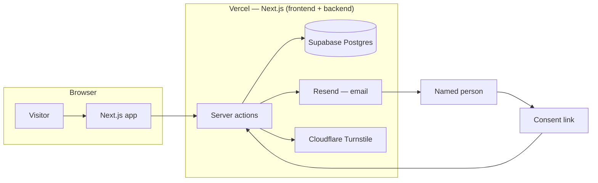
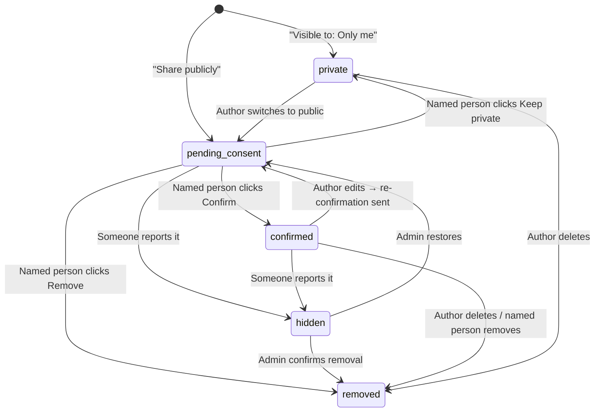
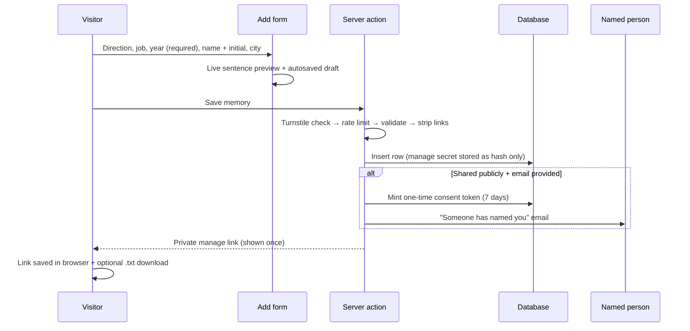
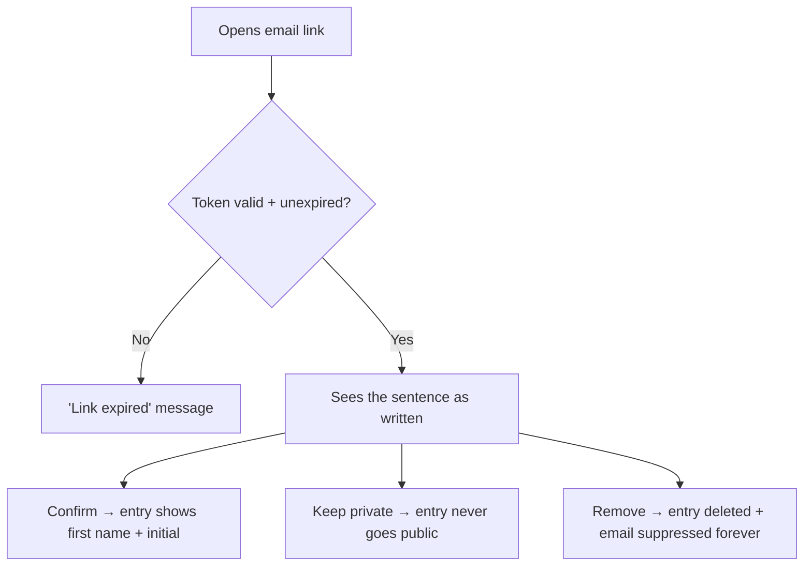
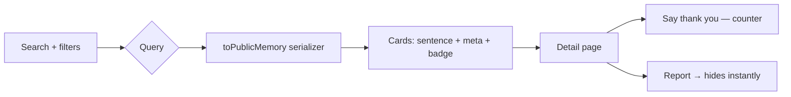
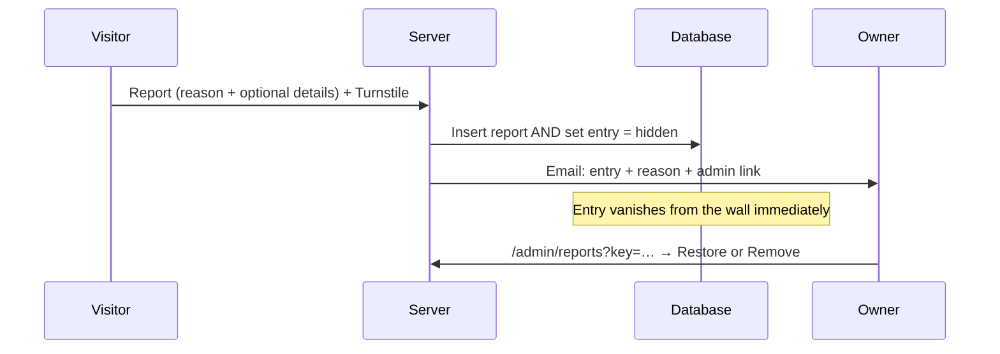

# Workbrook Memory — How It Works

A walkthrough of every workflow in the app, for presentation and review.

> **What it is:** a free public record of who helped people land work.
> No accounts, no passwords — private by default, consent first.

---

## 1. System at a glance



- **Frontend + backend = one Next.js app** (App Router, TypeScript)
- **Database:** Supabase Postgres via Drizzle ORM
- **Email:** Resend (fixed templates only)
- **Bot check:** Cloudflare Turnstile
- **Hosting:** Vercel — installable PWA

---

## 2. Entry lifecycle (state machine)

Every memory moves through exactly one path:



**Public wall shows only `pending_consent` + `confirmed`.**
Private, hidden, and removed entries never appear.

---

## 3. Adding a memory — `/add`



**Key rules**

- Only **year** is required — everything else optional
- Text fields are length-capped; URLs are rejected
- The **manage secret is never stored** — only its SHA-256 hash. Lose it and no email on file = entry is unmanageable (the warning dialog covers this)

---

## 4. Consent — `/named/[token]`

The named person gets one link that works **once**:



- Viewing the page **doesn't consume** the link — only the button press does
- After any choice, the token is dead — replaying it shows "already used"

---

## 5. The public wall — `/memories`



**Privacy boundary:** every byte reaching the browser goes through
`toPublicMemory()` —

| Stored in DB              | Public shows              |
| ------------------------- | ------------------------- |
| `Ada` + `O` (confirmed)   | "Ada O."                  |
| `Ada` + `O` (unconfirmed) | "A. O." — initials only   |
| `authorEmail`             | **never sent**            |
| `personEmail`             | **never sent**            |
| `manageSecretHash`        | **never sent**            |

- Searchable: first name, job, city, region, year
- `noindex` on all memory routes — browsable, not Googleable

---

## 6. Reporting — every public entry carries it



- Report = **hide first, review later** (the plan's default)
- Rate-limited to 5/day/IP

---

## 7. Managing your own entries — no accounts

```mermaid
flowchart TD
    A[My entries page] --> B{Manage links in browser?}
    B -- Yes --> C[Resolves each saved secret → entry cards]
    C --> D[/manage/secret → edit, delete, CSV export]
    B -- Lost --> E["Recovery form → enter your email"]
    E --> F["One-time /manage/token links emailed (1h expiry)"]
    F --> D
    D --> G[Edit confirmed entry → resets to unconfirmed + re-sends consent]
```

**Why recovery links exist:** manage secrets are stored hashed — the
server can't re-send them. Recovery issues fresh one-time tokens instead.

**CSV export:** all entries sharing your `authorEmail` — yours only, never
anyone else's.

---

## 8. Abuse defenses (per the plan)

| Threat                          | Defense                                        |
| ------------------------------- | ---------------------------------------------- |
| Bots                            | Turnstile on every public mutation             |
| Spam submissions                | 10/day per IP on add, 5/day on report          |
| Email bombing                   | Fixed templates, 3/day per address, stop list  |
| Secret guessing                 | 256-bit random secrets, stored only as SHA-256 |
| Link-injection in text          | All fields reject `http(s)://` and `www.`      |
| Editing someone else's name     | Edits to confirmed entries reset to unconfirmed |
| Lost secrets resurfacing        | Consent/recover/export tokens are one-time     |
| Recovery email probing          | Identical response whether or not email exists |

---

## 9. Pages map

| Route                  | Purpose                                        | Indexed |
| ---------------------- | ---------------------------------------------- | ------- |
| `/`                    | Search + two CTAs + latest public entries      | yes     |
| `/add`                 | Form + live preview + manage-link handoff      | yes     |
| `/memories`            | Public wall — search, filters, cards           | no      |
| `/memories/[id]`       | Detail — thank you + report                    | no      |
| `/named/[token]`       | Consent screen (one-time link)                 | no      |
| `/my-entries`          | Entries from your saved links + recovery       | no      |
| `/manage/[token]`      | Edit / delete / CSV — secret or recover token  | no      |
| `/privacy`             | Plain-language privacy commitments             | yes     |
| `/admin/reports`       | Minimal review queue (`?key=ADMIN_KEY`)        | no      |

---

## 10. Navigation

- **Desktop:** royal-blue sidebar (Home, Add a memory, Memories, My entries, Privacy)
- **Phone:** bottom bar (Home · Add · My entries) + top-left hamburger → slide-in panel
- **PWA-ready:** shell is server-rendered and light for basic phones

---

## 11. What's left (Phase 6)

- WCAG 2.2 AA pass + `prefers-reduced-motion`
- Vitest suite: one-time tokens, report-hides, rate limits, no-surname API
- Serwist service worker (installable PWA)
- Staging deploy + launch checklist
